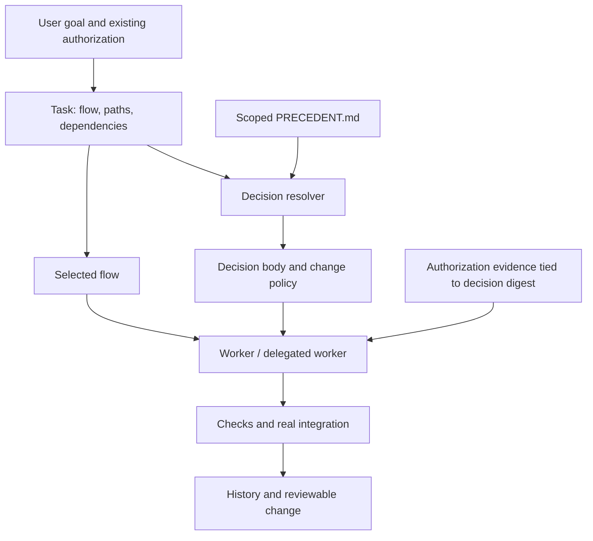

# Architecture and boundaries

## Independent implementation

agentic-core's small entry point, task-specific flows and history informed the workflow layer.
The two Context Engineering articles informed arrival-time context and authority-aware handoffs.
This is an independently written MVP, not a vendored fork, not compatible with every upstream
flow, and not a reproduction of the author's plugin or experimental results. No upstream source
files are copied. The previous comparison inspected agentic-core main on 2026-10-29.

- agentic-core: https://github.com/jongsaaa/agentic-core
- Arrival-time context (2026-10-10): https://zeriong.tistory.com/126
- Context-Rail follow-up (2026-10-24): https://zeriong.tistory.com/127
- Claude hook protocol: https://code.claude.com/docs/en/hooks (checked 2026-10-29)

## Record model

- `.rail/CORE.md`: short entry and governance policy.
- `.rail/flows/*.md`: selected process; init preserves project customizations.
- `PRECEDENT.md`: local decisions with stable globally unique IDs and scoped bodies.
- `.rail/tasks/<id>.json`: local goal, flow digest, paths, dependencies, decision snapshots,
  authorization evidence and check observations. Not committed by default; export a brief or
  reviewed evidence into PRs when cross-machine coordination is needed.
- `.rail/state/receipts/`: session + agent + context-digest delivery receipts. Not user consent.
- `.rail/runtime/`: copied stdlib runtime for project-local execution.

All matching ancestor records apply. A closer decision does not silently shadow a global one.
Conflicts between two applicable decisions require resolution; the parser does not infer
semantic priority. Stable IDs and content hashes keep stale approvals from being rebound.

## Delivery versus enforcement

Claude PostToolUse(Read/Bash) and PostToolUseFailure(Bash) deliver matching complete bodies.
Shell recognition uses literal existing path operands only and never executes the command.
Expansion, globs, aliases, cd chains, scripts and arbitrary shell writes are not fully covered.
Use `context` explicitly for those cases. Codex and other hosts use CLI + AGENTS.md; no native
Codex hook compatibility is claimed in this release.

PreToolUse(Edit/Write/MultiEdit) stops a first edit if the session/agent has no receipt for
current context, delivers it, and lets a subsequent retry follow ordinary host permissions.
This creates a model turn before editing when needed. A receipt says only that a payload was
emitted. It does not prove it was read or obeyed. No `allow` permission override is returned.
Context is re-injected on matching access even with a receipt to tolerate compaction.
Missing session IDs conservatively cause repeated first-edit stops; use a proper host event.

The 8000-byte budget is conservative, not a claim about a universal host limit. Overflow never
truncates a prohibition silently: narrow scopes/sections; explicit CLI reads can use a larger
budget. Invalid records block supported edits and report errors on post events. Failures outside
those tool routes are not covered. Hook timeout/host disablement is also outside this guarantee.

## Authority and completion

Only real conflicts lacking existing user authorization require clarification. The user need
not pronounce an exact decision ID if their authorization unambiguously covers the decision
and change. Record the exact instruction and source; do not fabricate a quote. Subagents inherit
that evidence and scope, not blanket permission from a caller.

`task approve` records an operator assertion. Any local agent can write those files; it is NOT
cryptographic proof of user approval. A trusted external approval service, protected CI checks
and repository review policy are required for tamper-resistant enforcement. Similarly recorded
PASS evidence is not automatically executed or authenticated. Rail never runs evidence text.

`task reconcile` accepts new scoped decisions and changes to existing snapshots only with
original-digest approval records. It retains old snapshots and does not rebind old approvals.
It cannot prove the new text fits the approved semantic scope; review must do that.

Same task IDs have one writer. Use separate tasks/worktrees for parallel work. Task dependency
checks and briefs prevent a knowingly unfinished predecessor from being handed off; they do
not schedule workers or acquire distributed file locks. An already finished predecessor's
code can still drift: pin actual Git revisions in evidence and run integration again.

## Validation scope

Automated tests verify parser, scoping, containment, initialization, payloads, delivery receipts,
stale approvals, task dependencies and actual CLI subprocess lifecycle. They do not establish
LLM compliance rates or token savings. Claude/Codex interactive live sessions are NOT_RUN in
this environment. Benchmarks with no-hook / pointer / body / body+policy conditions and human
review remain required before claiming productivity or behavioral improvements.
