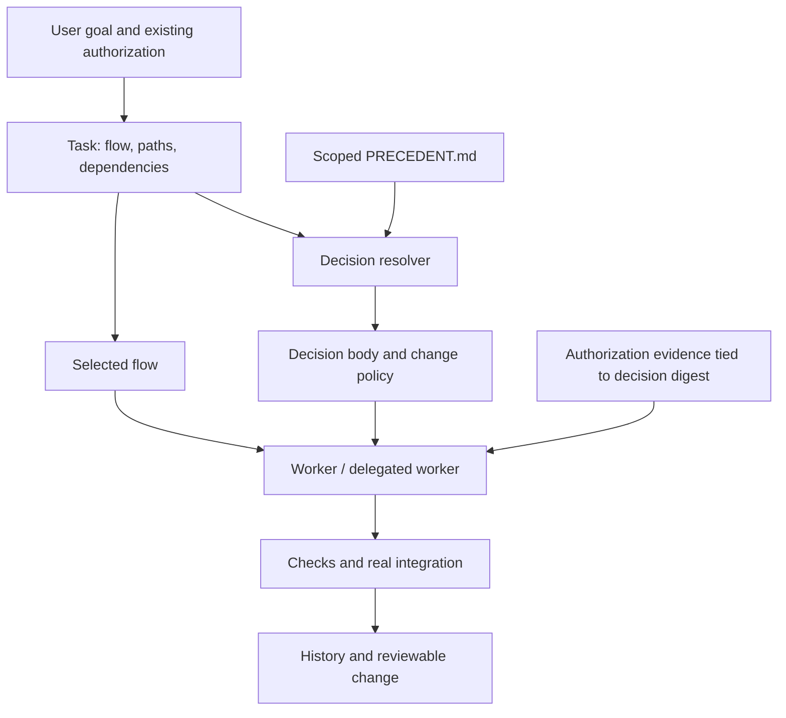

# Architecture and boundaries

## v0.3.0: collaboration owns integration, development produces ready tasks

One Rail CLI has nested responsibilities. `process.py` controls v2 per-task development:
analyze/design/implement/verify/review, ending in ready after unit/contract/mock checks and
recorded PR request/approval. `collaboration.py` groups ready tasks and owns milestone timing,
actual integration, affected-task rework and reflection. Neither calls GitHub or runs tests.
See [development process](development-process.md) for the complete lifecycle and six domains.

- `.rail/process.json`: v2 fixed five development stage IDs with editable instructions/domains.
- `.rail/tasks/<id>.json`: development stage/cycle, owner, contract, providers, checks, PR review.
- `.rail/collaborations/<id>.json`: members, mode/batch, trigger, exact attempt snapshots,
  actual integration environment/revision, results, affected tasks and reflection metrics.
- `.rail/COLLABORATION.md`: project policy guidance. Existing customized files remain preserved.
- `process_v1.py`: preserved eight-stage implementation for existing v1 project definitions.
- `process graph`: relationship export, not an ontology-driven execution engine.

A milestone plan requires an explicit reached flag plus all approved members ready. Readiness
alone cannot start integration. All providers must be included; mutual provider dependencies
are allowed because readiness does not require integration. --depends still means done first.
Each attempt pins task records (including source revision/cycle, contract, checks and reviews).
Recorded task changes invalidate prior integration; unrecorded source changes cannot be detected.
Rework clears readiness and review, and increments the cycle. A new attempt cannot reuse old
checks. Failed attempts persist. A completed integration can become invalidated after source
rework; inspect collaboration status rather than treating the stored done flag as timeless.

Local records have one writer and no automatic cross-repository synchronization. No authenticated
PR approval, CI polling, scheduler, automatic merge or actual model/test execution is claimed.
Existing v1 projects stay v1 on init; new v2 work uses a fresh workspace, without silent migration.
Legacy task behavior and scoped-decision/authorization mechanisms remain supported below.

## Independent implementation

agentic-core's small entry point, task-specific flows and history informed the workflow layer.
The two Context Engineering articles informed scoped decisions and authority-aware handoffs.
The arrival-time hook adapter was removed on 2026-11-02; delivery is explicit at task handoff.
This is an independently written MVP, not a vendored fork, not compatible with every upstream
flow, and not a reproduction of the author's plugin or experimental results. No upstream source
files are copied. The previous comparison inspected agentic-core main on 2026-10-29.

- agentic-core: https://github.com/jongsaaa/agentic-core
- Arrival-time context (2026-10-10): https://zeriong.tistory.com/126
- Context-Rail follow-up (2026-10-24): https://zeriong.tistory.com/127

## Record model

- `.rail/CORE.md`: short entry and governance policy.
- `.rail/flows/*.md`: selected process; init preserves project customizations.
- `PRECEDENT.md`: local decisions with stable globally unique IDs and scoped bodies.
- `.rail/tasks/<id>.json`: local goal, flow digest, paths, dependencies, decision snapshots,
  authorization evidence and check observations. Not committed by default; export a brief or
  reviewed evidence into PRs when cross-machine coordination is needed.
- `.rail/runtime/`: copied stdlib runtime for project-local execution.

All matching ancestor records apply. A closer decision does not silently shadow a global one.
Conflicts between two applicable decisions require resolution; the parser does not infer
semantic priority. Stable IDs and content hashes keep stale approvals from being rebound.

## Explicit delivery

`task brief` combines the goal, paths, dependencies, flow, scoped decision bodies and recorded
user authorization. The caller reads it at task start and passes it to the worker's prompt.
`process brief` also includes the current development stage's input/output requirements.
Rail does not invoke models or automatically dispatch tasks. `context <paths>` remains available
for explicit reads when the working scope expands.

There are no tool-event hooks, delivery receipts or first-edit blocks. `init --claude` only
adds CLAUDE.md guidance. Any init removes the exact legacy Rail hook command from existing
project settings, preserving other handlers, including those in mixed groups. It updates existing
managed CLAUDE.md blocks and backs up/removes the obsolete copied hooks.py. Custom legacy hook
commands require manual cleanup. Old receipt files are ignored. Restart host sessions after migration.

The default context budget is 8000 UTF-8 bytes; overflow fails rather than silently truncating
rules. Callers can set a larger explicit budget. Delivery does not prove model compliance, and
no runtime file-access enforcement is claimed.

## Authority and completion

Only real conflicts lacking existing user authorization require clarification. The user need
not pronounce an exact decision ID if their authorization unambiguously covers the decision
and change. Record the exact instruction and source; do not fabricate a quote. Subagents inherit
that evidence and scope, not blanket permission from a caller.

`task approve` records an operator assertion. Any local agent can write those files; it is NOT
cryptographic proof of user approval. A trusted external approval service, protected CI checks
and repository review policy are required for tamper-resistant enforcement. Similarly recorded
PASS evidence is not automatically executed or authenticated. Rail never runs evidence text.

`task reconcile` accepts new scoped decisions and changes to existing snapshots only with
original-digest approval records. It retains old snapshots and does not rebind old approvals.
It cannot prove the new text fits the approved semantic scope; review must do that.

Same task IDs have one writer. Use separate tasks/worktrees for parallel work. Task dependency
checks and briefs prevent a knowingly unfinished predecessor from being handed off; they do
not schedule workers or acquire distributed file locks. An already finished predecessor's
code can still drift: pin actual Git revisions in evidence and run integration again.

## Validation scope

Automated tests verify parser, scoping, containment, initialization and legacy migration,
stale approvals, task dependencies and actual CLI subprocess lifecycle. They do not establish
LLM compliance rates or token savings. Interactive model sessions are NOT_RUN in this environment.
