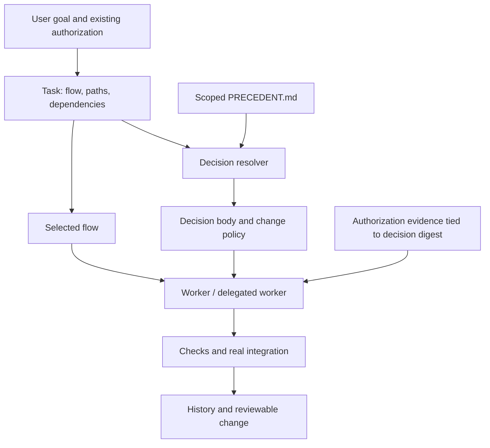

# Architecture and boundaries

## v0.2.0: development state graph inside collaboration

The project collaboration process owns assignment, contract acceptance, PR/CI review and
merge policy. A `process start` task records owner, contract reference, integration timing and
provider dependencies; its internal graph runs analyze/design/implement/verify/review/integrate/
handoff/reflect. `process.py` checks transitions and invalidates previous evidence on rework.
This is an explicit CLI state machine, not automatic model orchestration or ontology inference.
See [development process](development-process.md) for gates, the six-domain mapping and examples.

- `.rail/process.json`: stage input/output/domain definition; version 1 has fixed ordered IDs.
- `.rail/COLLABORATION.md`: project-customizable policy guidance, preserving existing collaboration.
- `.rail/tasks/<id>.json` `process`: current stage, cycle, collaboration envelope, milestones,
  stage history and metrics. Existing schema-1 tasks without this field keep legacy behavior.
- `process graph --format json`: typed stage/domain nodes and next/serves/rework edges.

Local unit/contract PASS and independent-review evidence can complete implementation before
live integration. Only integration PASS completes integration. Handoff and reflection finish
the local task, not the external PR. Reviewer strings and evidence are not authenticated.
New development reuses the existing scoped-decision and original-digest approval model below.

## Independent implementation

agentic-core's small entry point, task-specific flows and history informed the workflow layer.
The two Context Engineering articles informed scoped decisions and authority-aware handoffs.
The arrival-time hook adapter was removed on 2026-11-02; delivery is explicit at task handoff.
This is an independently written MVP, not a vendored fork, not compatible with every upstream
flow, and not a reproduction of the author's plugin or experimental results. No upstream source
files are copied. The previous comparison inspected agentic-core main on 2026-10-29.

- agentic-core: https://github.com/jongsaaa/agentic-core
- Arrival-time context (2026-10-10): https://zeriong.tistory.com/126
- Context-Rail follow-up (2026-10-24): https://zeriong.tistory.com/127

## Record model

- `.rail/CORE.md`: short entry and governance policy.
- `.rail/flows/*.md`: selected process; init preserves project customizations.
- `PRECEDENT.md`: local decisions with stable globally unique IDs and scoped bodies.
- `.rail/tasks/<id>.json`: local goal, flow digest, paths, dependencies, decision snapshots,
  authorization evidence and check observations. Not committed by default; export a brief or
  reviewed evidence into PRs when cross-machine coordination is needed.
- `.rail/runtime/`: copied stdlib runtime for project-local execution.

All matching ancestor records apply. A closer decision does not silently shadow a global one.
Conflicts between two applicable decisions require resolution; the parser does not infer
semantic priority. Stable IDs and content hashes keep stale approvals from being rebound.

## Explicit delivery

`task brief` combines the goal, paths, dependencies, flow, scoped decision bodies and recorded
user authorization. The caller reads it at task start and passes it to the worker's prompt.
`process brief` also includes the current development stage's input/output requirements.
Rail does not invoke models or automatically dispatch tasks. `context <paths>` remains available
for explicit reads when the working scope expands.

There are no tool-event hooks, delivery receipts or first-edit blocks. `init --claude` only
adds CLAUDE.md guidance. Any init removes the exact legacy Rail hook command from existing
project settings, preserving other handlers, including those in mixed groups. It updates existing
managed CLAUDE.md blocks and backs up/removes the obsolete copied hooks.py. Custom legacy hook
commands require manual cleanup. Old receipt files are ignored. Restart host sessions after migration.

The default context budget is 8000 UTF-8 bytes; overflow fails rather than silently truncating
rules. Callers can set a larger explicit budget. Delivery does not prove model compliance, and
no runtime file-access enforcement is claimed.

## Authority and completion

Only real conflicts lacking existing user authorization require clarification. The user need
not pronounce an exact decision ID if their authorization unambiguously covers the decision
and change. Record the exact instruction and source; do not fabricate a quote. Subagents inherit
that evidence and scope, not blanket permission from a caller.

`task approve` records an operator assertion. Any local agent can write those files; it is NOT
cryptographic proof of user approval. A trusted external approval service, protected CI checks
and repository review policy are required for tamper-resistant enforcement. Similarly recorded
PASS evidence is not automatically executed or authenticated. Rail never runs evidence text.

`task reconcile` accepts new scoped decisions and changes to existing snapshots only with
original-digest approval records. It retains old snapshots and does not rebind old approvals.
It cannot prove the new text fits the approved semantic scope; review must do that.

Same task IDs have one writer. Use separate tasks/worktrees for parallel work. Task dependency
checks and briefs prevent a knowingly unfinished predecessor from being handed off; they do
not schedule workers or acquire distributed file locks. An already finished predecessor's
code can still drift: pin actual Git revisions in evidence and run integration again.

## Validation scope

Automated tests verify parser, scoping, containment, initialization and legacy migration,
stale approvals, task dependencies and actual CLI subprocess lifecycle. They do not establish
LLM compliance rates or token savings. Interactive model sessions are NOT_RUN in this environment.
