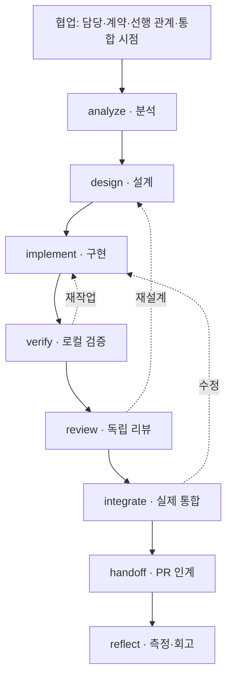

# 협업 프로세스 안의 개발 하네스 — v0.2.0

> 기존 process.json version 1 프로젝트용 보존 문서입니다. 새 v2 흐름은 [현재 문서](development-process.md)를 따릅니다.

## 범위

기존 협업 정책을 유지하면서 작업 내부를 키워드 단계로 실행·기록합니다.
담당자, 소유 파일, 승인된 계약 참조, 선행 작업, 통합 시점은 작업 시작 시 정하고
모든 brief에 전달합니다. PR 승인·병합·배포 권한은 기존 저장소 정책에 남깁니다.
이 문서의 8개 개발 단계는 이번 구현의 기본안이며 회의에서 확정한 8단계라는 뜻이 아닙니다.
회의 정리의 6개 항목은 단계가 아니라 전 과정에 적용하는 운영 영역입니다.

## Core에서 참고한 연결 방식

2026-11-02 확인한 upstream은 Core 라우팅 → flow 문서/템플릿 → 실행·검증 → 기록으로
연결합니다. code flow의 단계는 Read → Implement → Verify → Land → Done입니다.
역할은 explorer/worker/checker 등의 지침으로 연결하며 실행 호스트가 호출합니다.
확인한 flow/steps 문서 자체는 LangGraph나 온톨로지 추론 엔진이 아닙니다.
과거 upstream의 모든 버전을 조사한 것은 아니므로 이전 그래프가 삭제됐다고 단정하지 않습니다.

- [Core overview](https://github.com/jongsaaa/agentic-core/blob/main/flows/base/ref/overview.md)
- [Code steps](https://github.com/jongsaaa/agentic-core/blob/main/flows/code/ref/steps.md)
- [Role rules](https://github.com/jongsaaa/agentic-core/blob/main/agents/common.md)

Rail은 소스를 복제하지 않고 단계별 입력·산출물·검증과 역할 분리를 참고했습니다.
Core의 자동 push/배포 규칙은 가져오지 않습니다. 프로젝트의 리뷰/병합 정책이 우선합니다.

## 실행 그래프

`.rail/process.json`은 단계별 목적·입력·산출물·운영 영역의 정본입니다.
`process.py`의 STAGES와 전환 검사가 허용 순서 및 게이트를 정의합니다.
버전 1은 아래 8개 단계의 순서를 고정하며 문구와 운영 영역 매핑만 프로젝트별로
수정할 수 있습니다. 단계 추가·재정렬은 JSON 수정만으로 허용하지 않습니다.
정의가 바뀌면 진행 중인 작업은 새 작업으로 재계획해야 합니다.



`process graph`는 동일한 단계 정의에서 Mermaid를 생성합니다.
`process graph --format json`은 stage/domain 노드와 next/serves/rework 관계를 내보냅니다.
Mermaid는 대표 재작업 경로만 표시하고 JSON은 허용된 전체 재작업 관계를 포함합니다.
이는 명시적인 상태 그래프와 관계 모델이며, RDF/OWL 추론이나 자동 의미 해석은 아닙니다.

| 관계 | 저장 위치 / 의미 |
|---|---|
| Task → owner / paths | 책임·소유 범위. 파일 잠금이나 실제 접근 제어는 아님 |
| Task → contract_ref | 작업이 기준으로 삼은 합의된 계약 리비전 |
| Task → depends | 완료가 필요한 강한 선행 작업 |
| Task → providers | 실제 통합 시에만 완료가 필요한 제공자 작업 |
| Task → Decision | 결정 ID와 해시, 실제 승인 지시·출처·변경 범위 |
| Task → Stage → Check | 단계·재작업 사이클·소스 리비전별 검증 기록 |
| Stage → Domain | 해당 개발 단계가 담당하는 운영 영역 |
| Task → PR / Metric | 인계 대상과 결함·재작업 시간 |

## 여섯 운영 영역의 구현과 경계

| 영역 | 이번 구현 | 외부 또는 후속 범위 |
|---|---|---|
| Governance | 담당자·별도 리뷰어, 승인 근거, 인계 PR 기록 | 사용자 인증, GitHub 승인 수/보호 규칙 검사 |
| Knowledge | 계약 참조·결정·현재 단계 입력/산출물을 brief로 전달 | 외부 문서 자동 수집, 계약 버전 최신성 감시 |
| Orchestration | 단계 전환·선행 조건·제공자 조건·재작업 경로 | 모델 호출, 작업자 스케줄러, 분산 잠금 |
| Engineering | 분석·설계·구현의 산출물 기록 및 소스 리비전 | 설계 내용의 의미 검증, 프레임워크별 실행 어댑터 |
| Quality | 로컬 unit/contract 및 실제 integration 기록 게이트 | 테스트 직접 실행, CI 수집, 자동 배포·복구 |
| Intelligence | 단계별 시각·결함 수·재작업 분 기록과 합계 | 자동 계측, 생산성 인과 분석, 절차 자동 개선 |

여섯 영역이 모델에 표현됐다는 것과 모든 영역이 자동화됐다는 것은 다릅니다.

## 완료와 병렬 개발

- `verify`: 현재 사이클·현재 리비전의 unit PASS와 contract PASS가 필요합니다.
  프로젝트가 요구하는 build/type/lint도 수행하고 근거를 기록합니다. 해당 명령을
  Rail이 자동 발견하지 않으므로 프로젝트별 필수 검사 전체를 보장하지 않습니다.
- `review`: 구현 담당자와 다른 리뷰어/세션의 근거를 기록하면 implementation_complete=true.
  Mock으로 진행한 구현은 여기까지 완료할 수 있습니다.
- `integrate`: 제공자 작업이 완료되고 현재 단계의 integration PASS가 있어야 합니다.
  계약/FE/BE의 정확한 리비전과 실제 실행 환경을 evidence에 기록합니다.
  G0~G4 이름과 범위는 프로젝트 정의를 사용하고, 아직 실행하지 않은 검사는 NOT_RUN입니다.
- `handoff`: PR 참조가 있어야 인계할 수 있습니다. GitHub 승인·병합을 수행하지 않습니다.
- `reflect`: 현재 사이클의 실측 지표와 회고 근거가 있어야 작업이 done이 됩니다.
  done은 병합·배포 완료를 뜻하지 않습니다.

`--integration-mode per-pr`와 `milestone --batch M1` 모두 허용합니다.
PR별/묶음별 실제 통합 실행 시점은 담당자가 결정하며 Rail은 스케줄러가 아닙니다.
강한 `--depends`가 미완료면 단계 진행이 막힙니다. 미구현 제공자는 `--provider`로
지정해 분석~Mock 구현을 먼저 진행할 수 있습니다. 상호 의존하는 두 작업을 서로의
완료 조건으로 걸면 교착하므로 공통 통합 작업/실제 리비전 근거로 조율해야 합니다.

## CLI 예시

새 프로젝트에서는 init 후, 기존 설치에서는 새 버전의 init --dry-run → init 후 사용합니다.
기존 사용자 flow와 CORE.md는 보존됩니다. 새 COLLABORATION.md/process.json이 추가되고
AGENTS.md의 관리 블록이 새 진입점을 안내합니다. 기존 task는 자동 전환하지 않습니다.

```bash
python3 .rail/runtime/rail.py process start permission-02 \
  --goal '권한 조회 API 구현' --owner permission-worker \
  --path backend/permission.py --path frontend/permission.ts \
  --contract-ref 'contract@<accepted-commit>' \
  --integration-mode milestone --batch M1
python3 .rail/runtime/rail.py process brief permission-02
python3 .rail/runtime/rail.py process advance permission-02 --stage analyze \
  --actor permission-worker --evidence 'docs/permission-analysis.md: 영향 범위와 완료 기준'
python3 .rail/runtime/rail.py process advance permission-02 --stage design \
  --actor permission-worker --evidence 'docs/permission-design.md: 인터페이스·검증 계획'
python3 .rail/runtime/rail.py process advance permission-02 --stage implement \
  --actor permission-worker --revision 'backend@<sha>;frontend@<sha>' \
  --evidence '구현 diff와 소유 파일 확인'
```

실제 로컬 검사를 실행한 뒤에만 결과를 기록합니다. 아래 evidence는 실제 명령과 로그로
대체해야 합니다. Rail은 evidence 문자열을 실행하지 않습니다.

```bash
python3 .rail/runtime/rail.py task record-check permission-02 --name unit \
  --kind unit --result PASS --evidence '<실제 실행 명령·로그·대상 리비전>'
python3 .rail/runtime/rail.py task record-check permission-02 --name contract \
  --kind contract --result PASS --evidence '<실제 계약 검증 명령·로그>'
python3 .rail/runtime/rail.py process advance permission-02 --stage verify \
  --actor permission-worker --evidence '<로컬 검사 결과 요약>'
python3 .rail/runtime/rail.py process advance permission-02 --stage review \
  --actor independent-reviewer --evidence '<독립 검토 기록>'
python3 .rail/runtime/rail.py process status permission-02
```

이 시점은 구현 완료·통합 대기입니다. 실제 통합을 수행한 다음:

```bash
python3 .rail/runtime/rail.py task record-check permission-02 --name live \
  --kind integration --result PASS --evidence '<실제 FE/BE 실행·리비전·로그>'
python3 .rail/runtime/rail.py process advance permission-02 --stage integrate \
  --actor integration-reviewer --evidence '<통합 결과>'
python3 .rail/runtime/rail.py process advance permission-02 --stage handoff \
  --actor permission-worker --pr '<PR URL>' --evidence '<리뷰 요청·남은 위험>'
python3 .rail/runtime/rail.py process metric permission-02 \
  --defects 0 --rework-minutes 0 --evidence '<실측 기록; 예시 수치를 그대로 쓰지 않음>'
python3 .rail/runtime/rail.py process advance permission-02 --stage reflect \
  --actor permission-worker --evidence '<개선점과 측정 해석>'
```

실패나 소스 수정이 있으면 `process rework <id> --to implement --actor <name> --reason <reason>`
으로 돌아갑니다. 이전 검사·리뷰·통합 완료 표시는 새 사이클에 재사용하지 않습니다.
설계 변경이면 design 또는 analyze로 돌아갑니다. 결정 변경은 기존 approve/reconcile 후
rework가 필요합니다. 이미 done인 작업은 수정하지 말고 후속 작업을 만듭니다.

## 검증 한계

상태 전환은 CLI로 검사하지만 로컬 JSON을 직접 쓰는 작업자를 보안적으로 막지 않습니다.
source revision, actor, contract ref, evidence는 운영자 기록입니다. 소스 변경이나 리뷰
신원을 자동 인증하지 않습니다. 모델 호출·테스트 실행·필요한 시점의 brief 전달은 호스트
책임입니다. 훅·실시간 문맥 주입은 재도입하지 않습니다. 실제 모델 세션 검증은 NOT_RUN입니다.
이 범위는 하네스의 상태 관리 기반이며 완성된 자율 실행 엔진이라고 주장하지 않습니다.
