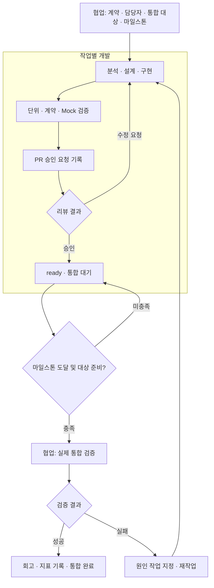

# 협업 안의 개발 흐름 — v0.3.0

하나의 Rail에서 `process`는 개별 개발 작업, `collaboration`은 여러 작업의 통합을 관리한다.
PoC의 기본 방향은 **계약 기반 병렬 개발 → Mock 검증 → PR 승인 요청·리뷰 → 마일스톤 사후 통합**이다.
개발 작업의 `ready`는 통합 준비 완료이며, 협업 묶음의 `done`만 실제 통합 검증 완료를 뜻한다.
어느 상태도 GitHub 병합 또는 배포 완료를 뜻하지 않는다.

## 책임과 시작 시점

| 범위 | 상태와 책임 |
|---|---|
| 개별 개발 | analyze → design → implement → verify → review → ready |
| PR 리뷰 | not_requested → requested → approved 또는 changes_requested |
| 협업 통합 | waiting → running → done 또는 failed; 대상 변경 시 status는 invalidated |
| 사후 통합 시작 | 합의한 마일스톤 도달 근거 + 명시적인 시작 명령 + 모든 대상 작업 ready |
| 재작업 | 실패한 통합의 affected 작업을 implement로 반환; 기존 검사·승인 무효화 |

Mock은 별도 `mock` 검사 종류다. verify에는 현재 cycle/revision의 unit, contract, mock PASS가
필요하다. Mock이 필요 없는 작업도 계약 경계를 대체한 검증 방식을 근거에 명시해야 하며,
실행하지 않은 Mock 검사를 PASS로 기록하면 안 된다. 해당 PoC 흐름이 맞지 않는 작업은
기존 task 흐름을 사용한다. 실제 통합 검사는 개발 작업에서 기록하지 않는다.

PR 요청과 승인 명령은 **실제로 수행한 GitHub 요청/리뷰의 근거를 기록**한다.
GitHub 알림을 보내거나 리뷰 API를 호출하지 않는다. 요구 리뷰 수·필수 CI·계약 pin·병합 권한은
기존 저장소 정책으로 확인한다. Rail은 비어 있지 않은 참조와 다른 리뷰어 문자열을 검사할 뿐,
원격 계정이나 승인 진위를 인증하지 않는다.



## 실행 예시

초기화된 프로젝트 루트에서 실행한다. 아래 `rail` 함수는 복사 런타임을 부른다.
`<...>`는 실제 확인한 참조로 바꾼다. 명령은 기록을 관리하며 테스트 자체를 실행하지 않는다.

```bash
rail() { python3 .rail/runtime/rail.py "$@"; }
rail process start permission --goal '권한 조회' --owner permission-dev \
  --path backend/permission.py --contract-ref 'contract@<sha>' \
  --integration-mode milestone --batch M1 --provider auth
rail process start auth --goal '인증 제공' --owner auth-dev \
  --path backend/auth.py --contract-ref 'contract@<sha>' \
  --integration-mode milestone --batch M1

# 개발 시작 때부터 협업 담당자가 대상과 시작 조건을 명시한다.
rail collaboration create M1 --task auth --task permission --batch M1 \
  --check G3-G4 --owner coordinator --trigger 'Auth·Permission 리뷰 완료 후 M1 연동 점검'
rail process brief permission
rail process advance permission --stage analyze --actor permission-dev --evidence '<분석 산출물>'
rail process advance permission --stage design --actor permission-dev --evidence '<설계 산출물>'
rail process advance permission --stage implement --actor permission-dev \
  --revision 'backend@<sha>' --evidence '<변경 diff>'
rail task record-check permission --name unit --kind unit --result PASS --evidence '<단위 테스트 로그>'
rail task record-check permission --name contract --kind contract --result PASS --evidence '<계약 테스트 로그>'
rail task record-check permission --name mock --kind mock --result PASS --evidence '<Mock 테스트 로그>'
rail process advance permission --stage verify --actor permission-dev --evidence '<검증 요약>'

# 실제 GitHub에서 요청한 다음 해당 근거를 기록한다.
rail process request-review permission --pr '<PR URL>' --actor permission-dev --evidence '<승인 요청 근거>'
rail process review-result permission --result approve --actor reviewer --evidence '<GitHub 리뷰 URL>'
rail process advance permission --stage review --actor permission-dev --evidence '<승인 확인>'
# 수정 요청이면 --result request-changes 기록 후 process rework로 되돌린다.

# auth도 동일한 개발·검증·PR 리뷰를 마쳐 ready가 되어야 한다.
rail collaboration status M1
# 준비만 됐다고 자동 시작하지 않는다. 합의된 시점 도달도 명시한다.
rail collaboration start M1 --actor coordinator --milestone-reached \
  --evidence '<마일스톤 도달 확인>' --revision 'backend@<sha>,frontend@<sha>,contract@<sha>' \
  --environment '<실제 서비스 통합 환경>'
# 실제 서비스를 연동하여 테스트한 뒤 기록한다. Mock 결과는 사용할 수 없다.
rail collaboration record-check M1 --name G3-G4 --result PASS --actor tester --evidence '<실제 연동 로그>'
rail collaboration finish M1 --actor coordinator --defects 0 --rework-minutes 0 --evidence '<회고와 측정 근거>'
```

`collaboration create --check`로 필수 실제 통합 검사 이름을 미리 선언한다. 여러 개면 옵션을
반복한다. 선언한 검사가 모두 PASS이고 추가로 기록한 검사도 모두 PASS여야 완료할 수 있다.

통합 전에 변경을 임시 통합 브랜치/환경에 취합할 수 있다. 승인된 PR을 먼저 통합 브랜치에
병합할지, 마일스톤에 한꺼번에 병합할지는 기존 협업 정책에 따른다. 위 명령은 병합 순서를
강제하거나 자동 병합하지 않는다. **사후처리의 기준은 실제 통합 검증 시점**이다.

## 통합 실패 및 소스 변경

```bash
# running 상태에서 실패를 기록하면 해당 시도는 failed가 된다.
rail collaboration record-check M1 --name G3-G4 --result FAIL --actor tester \
  --affected permission --evidence '<실패 로그와 원인>'
rail collaboration rework M1 --task permission --actor coordinator --evidence '<수정 범위>'
```

대상 작업의 cycle이 증가하고 revision·검사·PR 승인이 재사용되지 않는다. 구현부터 다시
검증하고 PR 승인 요청·승인을 기록해 ready가 된 후 `collaboration start`로 다음 통합 시도를
시작한다. 여러 원인 작업이면 `--affected`를 반복하고 각 작업을 재작업한다.
기존 시도의 실패 근거는 보존한다. 미실행은 NOT_RUN으로 기록하며 완료를 막는다.

통합 실패 외의 소스 변경도 **반드시** `process rework`로 기록해야 한다. Rail은 Git 작업 트리를
감시하지 않는다. 기록된 작업 revision/cycle/계약/검증/승인/결정이 바뀌면 기존 통합 스냅샷은
무효이며, 완료했던 묶음도 status에서 invalidated로 표시한다. 다시 준비한 뒤 새 시도가 필요하다.

## 의존성과 운영 영역

`--depends`는 완료(done)가 필요한 선행 작업이다. 계약 확정 같은 선행 작업에 사용한다.
병렬 개발 중 실제 연동 상대는 `--provider`로 연결한다. provider는 나중에 생성할 수 있고,
서로 provider여도 각자의 Mock 개발을 막지 않는다. 통합 시작 때는 모든 provider를 같은 묶음에
포함하고 ready인지 검사한다. 서로를 hard depends로 지정하면 병렬 진행할 수 없다.

| 운영 영역 | 담당하는 과정 |
|---|---|
| Governance | 담당자·계약 기준, PR 승인 근거, 통합 담당자 |
| Knowledge | 계약·설계·검증 근거·회고 |
| Orchestration | 작업 배정 정보, provider 관계, 묶음·마일스톤·재작업 대상 |
| Engineering | 개별 분석·설계·구현·Mock 검증 |
| Quality | 단위·계약 검증, PR 리뷰, 실제 통합 검증 |
| Intelligence | 통합 시도 이력, 결함·재작업 시간과 회고 |

6개 영역은 순차 실행 단계가 아니다. process.json은 개발 단계별 영역을, graph JSON은
협업 통합·회고까지 포함한 관계를 표현한다. 그래프 추론 실행 엔진은 아니다.

## 호환성과 한계

- 새 설치는 process 정의 v2. 기존 설치의 v1 process.json은 init으로 덮어쓰지 않는다.
  기존 v1 작업은 종전 8단계로 계속 동작한다. [v1 사용법](development-process-v1.md).
- 기존 진행 중인 작업의 정의를 v2로 교체하지 말 것. v2는 새 프로젝트/worktree에서 초기화해
  시작한다. v1 이력은 원래 작업공간에 보존한다. 자동 데이터 마이그레이션은 제공하지 않는다.
- v2에는 개발 작업별 integrate/handoff/reflect가 없다. PR 인계는 review에,
  통합·회고는 collaboration으로 이동했다. 기존 task 흐름은 그대로 지원한다.
- 하나의 협업 workspace에서 작업 상태를 관리한다. 파일은 로컬에 저장되며 여러 저장소나
  머신 사이를 자동 동기화하지 않는다. 각 저장소 revision과 외부 결과는 담당자가 기록한다.
- 작업/묶음별 단일 작성자가 필요하다. 분산 락·동시 쓰기 병합·자동 스케줄러가 없다.
- 실제 테스트 실행·GitHub 요청/승인/CI 조회·병합은 외부에서 수행한다. 기록한 참조의 진위는
  검증하지 않는다. 운영 상태와 결과를 정직하게 남기는 CLI이며 보안 경계가 아니다.
- per-pr도 지원한다. 작업과 묶음에 동일한 mode/batch를 지정하고 해당 PR의 통합 시작 근거를
  기록한다. 마일스톤 플래그만 생략하며 실제 통합 PASS 조건은 동일하다.
