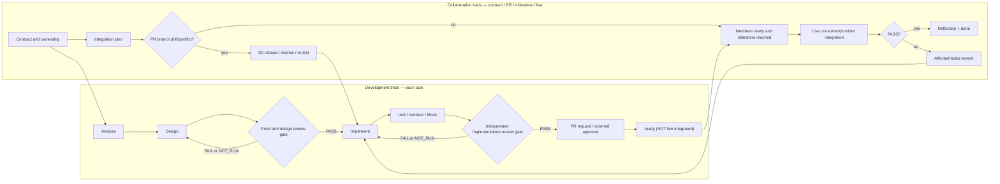
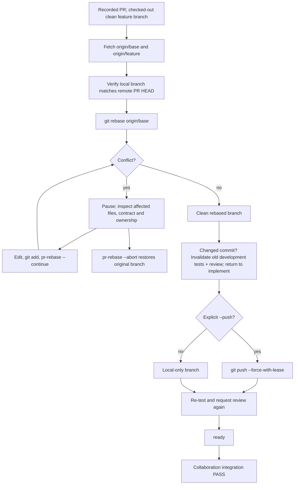

# Agentic Rail v0.4.0 — two tracks, flow and proof

This document describes implemented guards, not guaranteed model reasoning or authenticated approvals.

## Tracks and handoff



- Collaboration is responsible for contracts, owner boundaries, providers, PR conflicts, a milestone, pinned revisions, and **real** integration checks. It does not assert that a `ready` task has been integrated.
- Development is responsible for task-specific context, design, implementation, tests, and local review evidence. Its recorded proofs are checked by `process gate`; no LLM or test runner is invoked automatically.
- PR rebase is a collaboration operation targeting the current task branch. If it rewrites local commits, the development task is reworked into `implement` with a new cycle; previous verification and PR review cannot be reused.

## Development intensity and delegation

When starting a **new v2** task, choose `--intensity 1|2|3` and optionally `--delegation off|auto|mass`. Existing v2 tasks lacking these keys continue using the former lifecycle without retroactive migration. v1 process definitions remain unchanged.

| Intensity | Recorded logical proof | Independent design review | Independent implementation review |
|---|---|---|---|
| 1, leaf | no additional proof gate | no | no (existing PR review still required) |
| 2, feature | premise, invariant, deduction, counterexample, contrapositive | only if delegation=mass | yes |
| 3, relationship | same five proof observations | yes | yes |

This implementation validates **presence, stage, owner/reviewer distinction, current cycle, current contract/decision snapshots and PASS outcome**, not logical semantic truth. A reviewer identity is operator-entered, not authenticated. The `off/auto/mass` attribute is advisory metadata, not automatic dispatch: Rail does not create subagents or enforce a 10/50 worker limit. This intentionally differs from agentic-core's own installed host tooling.

The five proof slots represent an evidence checklist:

1. `premise`: define user intent, inputs, state partitions and scope.
2. `invariant`: state conditions that cannot change (contract, ownership, security).
3. `deduction`: connect the proposed change to expected postconditions.
4. `counterexample`: test meaningful cases contradicting the conclusion.
5. `contrapositive`: if a required verification is false, the task cannot be considered done.

For intensity 2/3, record these slots while in `design` with `process prove`. Record `design-review` during design if required; record `implementation-review` during verify, once the revision is fixed. A `FAIL` or `NOT_RUN` result blocks advancement just as a missing record does. Rework increments the cycle and invalidates previous proof evidence.

```bash
rail process start feature --goal 'Permission API' --path backend/permission.py \
  --owner worker --contract-ref contract@sha --integration-mode milestone --batch M1 \
  --intensity 3 --delegation auto
rail process advance feature --stage analyze --actor worker --evidence 'Analysis reference'
rail process prove feature --kind premise --result PASS --actor worker --evidence 'Premise details'
rail process prove feature --kind invariant --result PASS --actor worker --evidence 'Invariants'
rail process prove feature --kind deduction --result PASS --actor worker --evidence 'Proof obligations'
rail process prove feature --kind counterexample --result PASS --actor worker --evidence 'Counterexamples'
rail process prove feature --kind contrapositive --result PASS --actor worker --evidence 'Negative checks'
rail process prove feature --kind design-review --result PASS --actor reviewer --evidence 'Independent source review'
rail process gate feature
```

## PR conflict recovery in collaboration

The conflict comparator is **the PR head branch against the latest target branch** (`main` by default), not a direct `PR #1` vs `PR #2` API comparison. When PR #1 lands, its changes enter the target branch and the still-open PR #2 is rebased onto that target. Git determines textual rebase conflicts. This cannot detect different-file semantic contract conflicts, which remain the responsibility of unit/contract/Mock and live integration checks.



Commands, on an already checked-out PR branch with no uncommitted tracked edits:

```bash
rail collaboration pr-rebase feature --branch feature/permission --base main \
  --actor owner --evidence 'main advanced' --push

# If Git stops at a conflicting hunk, resolve the source then:
git add path/to/resolved.py
rail collaboration pr-rebase feature --continue \
  --actor owner --evidence 'Reviewed conflict and preserved contract'

# Or, to cancel the in-progress Git rebase:
rail collaboration pr-rebase feature --abort \
  --actor owner --evidence 'Rebase postponed'
```

Neither `--continue` nor `--abort` silently resolves a source conflict. A changed branch must be re-tested and re-reviewed. `--push` is opt-in because a rebased branch rewrites commit identities. All repository branch-protection and required CI policies remain authoritative. The tool does not merge PRs, query GitHub approvals, authenticate identities, or prove a rebase is semantically correct.

## Scope of enforcement

- Enforced at **Rail CLI state transitions**: stage order, recorded proof gates, review/revision invalidation, PR rebase Git conflict stop, live integration checks, and stale member snapshots.
- Not enforced at **model/tool access**: host hooks were intentionally removed in v0.3.0. An agent can edit source files without calling Rail. True hard enforcement additionally needs host-specific hooks and protected CI / branch rules.
- Existing customized `.rail/process.json` files remain preserved. The v2 stage sequence itself is unchanged in v0.4.0.
